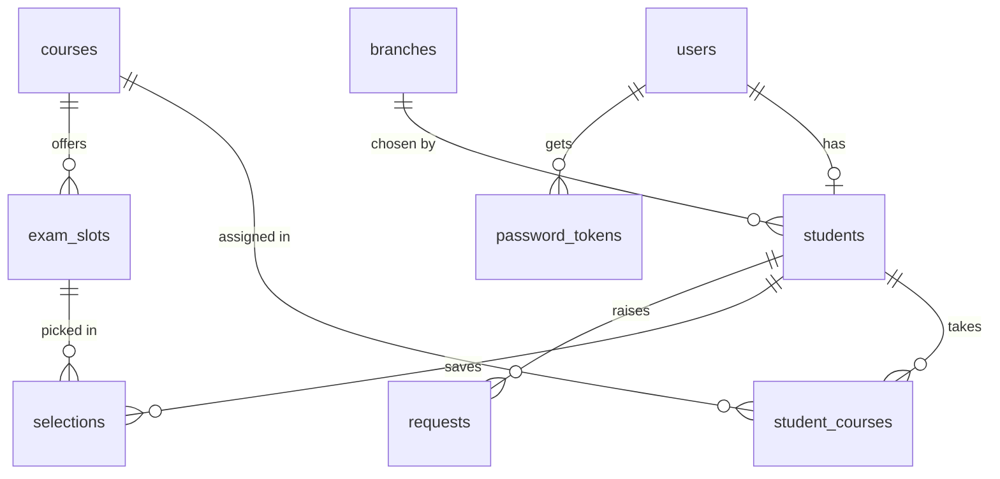

# ExamSlot (backend + website)

Node 22.13 or newer. Node, Express, SQLite (built into Node, nothing to compile), JWT. The website in `public/` is served by the same server, so one command runs everything.

## Run
    npm install
    copy .env.example .env      (Mac/Linux: cp .env.example .env)
    npm run dev
Open http://localhost:4000

`npm test` runs backend checks on an in-memory database.
Emails: with no SMTP settings the email (with its set-password link) is printed in the terminal. For real email use Mailtrap or Gmail SMTP in `.env`. The link points to `APP_URL` (default http://localhost:4000).

## Demo logins
- Admin: admin@examslot.test / admin123
- Students (password student123): ayesha.khan@student.edu (5 courses), bilal.khan@student.edu (3 courses, incomplete), hina.khanzada@, usman.ali@, sara.malik@student.edu

## Work without the backend
In `public/api.js` set `USE_MOCK = true` and open `public/index.html` by double-click. The fake server in `mock.js` follows the same rules.

## Routes
| Route | Who |
|---|---|
| POST /api/auth/login, /forgot, /set-password; GET /api/auth/me | anyone / logged in |
| GET /api/student/me; POST /api/student/branch, /sheet, /requests | student |
| GET, POST /api/admin/students; GET, PUT, DELETE /api/admin/students/:id; POST /:id/assign, /:id/unassign, /:id/setup-email | admin |
| GET /api/admin/requests (status, type, search, page, size); POST /api/admin/requests/:id/decide | admin |
| GET, POST /api/admin/branches; GET, PUT, DELETE /api/admin/branches/:id | admin |
| GET, POST /api/admin/courses; GET, PUT, DELETE /api/admin/courses/:id | admin |
| GET, POST /api/admin/exam-slots; GET, PUT, DELETE /api/admin/exam-slots/:id | admin |

The admin website includes branch, course, student, course-assignment, exam-slot, and change-request screens. Records in use are protected from deletion; mark branches or courses inactive instead. Exam slots are checked against all existing slots to prevent overlapping schedules, and a slot already selected by a student cannot be changed or deleted. New student accounts receive a one-time password setup email; use the student list's setup-email action to resend it.

The demo seed uses fixed January 2027 dates. Each course has two slots on dates unique to that course, so the demo choices do not clash and remain stable across seed runs.

## Files
- `src/db.js` tables and constraints; `src/seed.js` fixed-date demo data
- `src/auth.js` login check, role gate, one-time password links
- `src/clash.js` the same-date-and-overlapping-time rule
- `src/routes/` student.js, adminStudents.js, adminRequests.js, branches.js, courses.js, examSlots.js, auth.js
- `public/` the website (index.html, style.css, app.js, api.js, mock.js, set-password.html)

## Database diagram

## Assumptions
- A branch chosen by any student is never hard-deleted: the delete is blocked (409) and the admin should mark it inactive.
- A student's course assignment is locked once they save a date sheet, until a change request is approved.
- Approving a request unlocks the action once. Using it locks it again.
- Password links work once and expire after 24 hours. Only a hash is stored.
